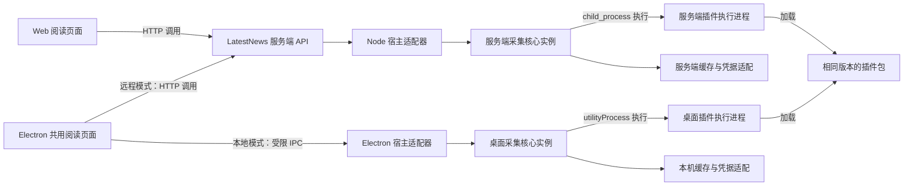

# 新闻采集插件平台调研与实施建议

日期：2026-10-18。状态：调研结论与实施方案；P0 原型、P1 SDK/CLI 首轮实现和 P2/P3 首轮宿主接入已完成。动态来源目录已有首轮实现；公开 UI 验收、完整桌面生命周期、插件更新和陌生代码隔离仍未完成。当前验收状态见 [插件平台进度记录](04-crawler-plugin-implementation-progress.md)。

源码基线：LatestNews `main`，`93dfe43`，应用版本 `0.6.1`。本轮检查现有采集路径，并查阅下文链接的官方文档与源码；没有对全部源站做在线可用性测试，也没有验证候选沙箱的性能。

## 1. 结论与目标

**可行。建议建设独立、可复用的 TypeScript 新闻采集插件平台，让同一个插件包由 Node 服务端和 Electron 本地宿主运行。LatestNews 作为首个接入应用，继续复用现有阅读界面。**

第一版的核心是统一开发接口、工具和执行规则。仅把现有文件改名或移动到 `plugins/`，无法明显降低开发难度。需要把请求、解析、条目校验、调度、诊断和测试工具一起标准化。

建议采用以下边界：

- 一个网站采集器对应一个插件。一个插件可以包含该网站的多个频道，避免为共享登录或签名逻辑重复打包。
- 服务端和桌面使用相同插件格式、SDK、条目模型与测试样例。宿主负责各自的进程、网络、凭据和存储。
- 桌面默认仍能使用远程 API；本地采集是可选执行方式。增加本地采集不需要在 Electron 中复制整套 Nitro 服务端。
- Web 浏览器使用服务端插件产生的数据。浏览器 CORS、Cookie 和后台生命周期限制，使“插件能在桌面运行”不能直接推导为“插件能在网页中直接采集”。
- 第一版只执行经过审核的自有或可信 JavaScript 插件。面向陌生作者开放自动安装前，必须完成单独的沙箱方案验证。

这调整了 [上一版平台计划](02-performance-sources-platform-plan.md) 中“采集仅在服务端执行”的假设。之前的远程 API 默认模式继续保留；本调研增加跨宿主插件与可选桌面本地执行的方案。

## 2. 术语与范围

| 术语 | 责任与边界 |
| --- | --- |
| 采集插件（Crawler Plugin） | 描述一个网站及其频道，实现读取源站并输出标准条目的逻辑；不管理用户收藏、登录或阅读界面 |
| 插件清单（Plugin Manifest） | 不可执行的数据文件，声明身份、版本、频道、参数、运行要求和申请的能力 |
| 采集 SDK（Crawler SDK） | 给插件作者使用的类型、请求接口、解析辅助函数、错误类型和开发工具 |
| 采集核心（Crawler Core） | 管理注册、兼容性、任务、并发、结果检查、缓存接口和健康记录；不依赖 Nitro 或 Electron |
| 宿主适配器（Host Adapter） | 把采集核心连接到 Node 或 Electron 的进程、网络、凭据和存储实现 |
| 执行器（Executor） | 实际运行任务的一份宿主实例，例如远端服务器或当前桌面设备；不是新的数据库组件 |
| 插件目录（Registry） | 提供插件清单、版本和下载地址；目录被列出或包有签名，不等于代码已经安全隔离 |
| 数据源实例（Source Instance） | 插件频道与一份参数配置的组合，例如同一 RSS 插件配置两个订阅地址 |

近期范围是新闻采集扩展。UI 扩展、数据库扩展和认证扩展不进入首版。平台也不负责自动解决站点改版、接口停用和网络环境差异。

## 3. 当前项目已经具备什么

以下数量来自本轮静态检查，不表示对应源站均可用：

| 检查项 | 当前事实 | 影响 |
| --- | --- | --- |
| 源码规模 | `server/sources` 有 54 个 TypeScript 文件，其中 52 个入口模块 | 适合渐进迁移，不宜一次重写全部实现 |
| 对外源列表 | `shared/sources.json` 有 76 个 ID，其中 16 个重定向条目、6 个 `disable: "cf"` 条目 | 插件、频道和旧别名不能简单按文件数一一对应 |
| 共同模式 | 静态文本匹配找到 17 个使用 Cheerio 的文件、5 个使用 RSS helper 的文件、41 个使用 URL 哈希 helper 的文件；分类可能重叠 | 大量工作可以由 SDK 统一承担，但不能据此断言其余文件都是简单 JSON 源 |
| 注册 | [server/getters.ts](../server/getters.ts) 与 [tools/rollup-glob.ts](../tools/rollup-glob.ts) 在构建时收集模块 | 当前是内置适配器机制，没有运行时插件安装、兼容检查和更新管理 |
| 函数接口 | [server/types.ts](../server/types.ts) 的 `SourceGetter` 为 `() => Promise<NewsItem[]>`；[defineSource](../server/utils/source.ts) 基本原样返回函数或映射 | 没有显式执行上下文，网络、时间和凭据常通过导入或全局对象访问 |
| 元数据 | [shared/pre-sources.ts](../shared/pre-sources.ts) 集中声明，脚本生成 `sources.json`、`pinyin.json` | 作者同时理解采集模块、全局元数据和生成流程，独立发布也受应用构建限制 |
| 源 ID 类型 | [shared/types.ts](../shared/types.ts) 的 `SourceID` 来自静态 JSON 的键集合 | 动态安装后，不能只修改服务端 getter，前端也需要运行时目录 |
| 标准化 | [shared/news-item-schema.ts](../shared/news-item-schema.ts) 已有字段清理、ID 补全、URL 去重和条数限制 | 应优先复用；还需在插件边界增加 URL 协议、字段长度、深度与总字节数检查 |
| 采集治理 | [source-fetch.ts](../server/utils/source-fetch.ts) 已有同源请求合并和健康回调；[resolve-source-response.ts](../server/utils/resolve-source-response.ts) 已有缓存回退 | 这些属于核心能力，不应在每个插件中重新实现 |
| 请求与批量等待 | [fetch.ts](../server/utils/fetch.ts) 默认单次超时 10 秒并重试 3 次；[resolve-entire-sources.ts](../server/utils/resolve-entire-sources.ts) 使用 `Promise.allSettled` 等待缺失源 | 插件标准必须补充整个任务的期限与统一并发预算，单次请求超时不等于任务总超时 |
| 桌面 | [electron/main.ts](../electron/main.ts) 的 API 通道调用远端；[prepare-electron-package.mjs](../scripts/prepare-electron-package.mjs) 生成无服务端依赖的桌面清单 | 现在没有本地采集宿主；需要增加执行适配器，但无需把完整服务端装入客户端 |

复杂度还有几个具体来源：

1. 采集模块直接依赖 `#/utils` 等服务端路径。新 SDK 必须移除对 LatestNews 内部路径的依赖。
2. 雪球源使用隐式 `$fetch.raw` 获取 Cookie，Product Hunt 源直接读 `process.env`，早报源依赖 Buffer 与 GB2312 解码。它们分别需要标准会话、凭据和编码能力。
3. `generateUrlHashId` 与条目标准化中的 ID 补全不是同一算法。迁移时必须保留旧 ID，防止收藏和历史记录失去关联。
4. 某些源把 `Date.now()` 写入 `pubDate`，例如当前 Steam 实现。平台要分别记录抓取时间与源站发布时间，发布时间未知时保持未知。
5. `NewsItem.extra` 包含展示字段。平台应输出稳定的采集数据，由 LatestNews 映射为现有展示模型，避免通用平台依赖 React、主题色或栏目布局。

## 4. 技术路线比较

以下适配性结论是基于源码与官方能力做出的工程判断，尚未进行运行原型比较。

| 方案 | 与现有代码的适配 | 服务端与桌面复用 | 主要代价 | 建议 |
| --- | --- | --- | --- | --- |
| 可信 TS/JS 插件 + 独立执行进程 | 高，保留 async/await、JSON、Cheerio 等主要写法 | 同一 JS 产物，两个宿主适配 | 需要 SDK、进程协议与治理；不能隔离恶意 Node 代码 | 首版推荐 |
| 直接采用 RSSHub 路由体系 | 可借鉴命名空间、路由元数据和统一输出 | 作为远程 RSS 服务很自然；直接成为本地独立插件还需适配 | 引入其服务端结构不等于获得插件安装机制 | 参考标准并保留 RSS 接入，不整体替换 |
| Crawlee 作为采集引擎 | 对多页抓取、队列、会话和浏览器采集有价值 | Node 环境可复用，浏览器依赖增加桌面负担 | 当前主要是小规模列表采集，引入整套引擎可能增加概念 | 作为后续可选执行后端 |
| QuickJS/WASM 执行 JavaScript | 需要适配网络、模块与解析依赖 | 同一受限 JS 包可用两个宿主加载 | 需要自行维护桥接、Promise 调度和资源限制 | 陌生插件沙箱候选 |
| Extism/WASM 插件 | 现有 TS 可以保留部分语法，但不是 Node 原样运行 | 同一 `.wasm` 可被不同宿主加载 | 编译工具链、库兼容和执行模型迁移成本较高 | 跨语言或陌生插件阶段候选 |
| 每个插件独立 HTTP 服务/容器 | 语言与运行环境自由 | 两端均能调用服务，桌面本地部署并不轻量 | 端口、进程、升级和容器依赖使每个爬虫运维成本变高 | 保留为特殊远程插件适配 |

官方资料支持的能力与限制：

- RSSHub 的 [命名空间示例](https://github.com/DIYgod/RSSHub/blob/master/lib/routes/hackernews/namespace.ts)、[路由示例](https://github.com/DIYgod/RSSHub/blob/master/lib/routes/hackernews/index.ts) 与 [类型定义](https://github.com/DIYgod/RSSHub/blob/master/lib/types.ts) 展示了元数据、路由和输出标准化。它们可作为开发规范参考，不能直接证明独立插件的安装或隔离能力。RSSHub 文档站本轮返回 403，因此改查官方仓库。
- Crawlee 提供请求队列及 HTTP/浏览器 crawler，适合确有多页抓取需求的源；它本身不替代本文的插件清单、版本和宿主接口。[官方入门](https://crawlee.dev/js/docs/introduction/first-crawler)
- QuickJS 包装库提供执行中断、堆内存和栈限制；网络与模块仍由集成方实现。宿主原生函数、网络缓冲区和整个进程的资源也需要另外约束。[官方运行时说明](https://github.com/justjake/quickjs-emscripten/blob/main/doc/quickjs-emscripten-core/classes/QuickJSRuntime.md)
- Extism 的 JS SDK 使用 JavaScript 环境自带的 Wasm 运行时，无需假定必须引入原生 FFI 库。但其 JS PDK 不提供完整 Node API，执行模型与普通 Node async 并发不同；不能把现有依赖直接打包后宣称全部兼容。[JS SDK](https://github.com/extism/js-sdk)、[JS PDK](https://github.com/extism/js-pdk)
- Extism 定义了内存、HTTP 和路径访问等清单项；选择具体 JS SDK 时仍需逐项验证实现支持，不能把其他语言 SDK 的配置示例当作桌面验收结果。[Manifest 说明](https://extism.org/docs/concepts/manifest/)

**第一版选择可信 TS/JS，不等于承诺以后只能支持 JavaScript。** 把插件元数据、任务与输出协议独立出来，未来可增加 Wasm 或远程执行后端。不要第一版同时维护多个引擎。

## 5. 推荐架构：一个核心，两个宿主

图中服务端核心与桌面核心是相同代码的两个运行实例。箭头表示调用或加载关系；结果沿各自请求通道返回，没有跨设备共享内存或自动共享凭据。



### 5.1 平台项目的边界

建议最终形成一个独立 monorepo。以下包名只是结构示例，不表示已经创建项目或发布 npm 包。

```text
crawler-platform/
  packages/
    sdk/             # 插件接口、类型与解析辅助函数
    core/            # 注册、调度、结果校验与健康状态
    host-node/       # Node 进程、网络和存储适配
    host-electron/   # utilityProcess 与受限 IPC 适配
    cli/             # 创建、调试、测试、校验、打包
    testkit/         # 响应回放、可控时间与标准验证
  plugins/
    example-json/
    example-html/
    example-rss/
```

`core` 与 `sdk` 不导入 Nitro、Electron、React、LatestNews 别名或数据库实现。LatestNews 只需要两个接入层：服务端把采集核心接到现有 API；桌面把本地数据提供器接到已有共用页面。

先用代表源验证抽取边界，再冻结独立平台接口。首轮不同时开发插件市场网站、账户系统和通用工作流编排器。

### 5.2 服务端

保留现有 API、SQLite/可选 D1、旧缓存回退和健康记录。`fetchSourceItems` 改为调用注册表与统一调度器，内置 getter 通过兼容适配器继续工作。

首版动态执行宿主以 Node/Docker 为范围。Cloudflare Pages Functions 使用 Workers runtime。当前 Workers 对 `node:child_process` 提供的实现是非功能性桩，不能用它启动 Node worker。因此 Pages 继续作为 Web 页面部署目标；需要运行服务端插件时，页面通过现有远程 API 配置连接 Node/Docker API。本文不要求新增单独的 Workers 部署。[Pages Functions](https://developers.cloudflare.com/pages/functions/)、[Node.js compatibility](https://developers.cloudflare.com/workers/runtime-apis/nodejs/)

### 5.3 Electron

由主进程验证请求并管理执行器，爬虫在 `utilityProcess` 中运行。该 API 提供启用 Node 的子进程及消息通道，可作为桌面宿主的进程基础；它不等于恶意代码沙箱。[Electron 官方说明](https://www.electronjs.org/docs/latest/api/utility-process)

桌面适配必须包括：

- 只开放列出源、采集、取消和管理已批准插件等具体 IPC，不开放任意模块路径或任意命令执行。
- 复用同一采集核心和插件产物，不启动本地 HTTP 服务，不引入完整 Nitro、用户数据库或服务端认证。
- 插件包保存在应用数据目录，按 ID/版本分目录；不修改安装目录中的 `app.asar`。
- 工作进程使用经过筛选的环境变量；不得继承整个服务端环境或主进程凭据。
- 关闭、更新、休眠和恢复时明确取消或恢复规则；退出后不能留下采集进程。
- 凭据按本机资料与插件隔离保存。Cookie 会话不复用应用登录会话。

实际 Electron 内置的 Node 版本与独立服务端版本可能不同。SDK 应使用两端共同能力，并通过兼容矩阵验证，不能仅依据两端都使用 TypeScript 宣称兼容。

### 5.4 共用前端

增加统一的数据提供接口，例如 `listSources / fetchItems / getHealth / cancel`。远程提供器调用现有 API，本地提供器调用受限 IPC，Feed、收藏和历史页面继续复用。

现有 `/api/v1/sources` 已扩展为运行时源目录。Node API 从启用插件清单生成动态 ID，Web 和 Electron renderer 在导入路由前验证并注册动态元数据。Pages 若要读取 Node 插件数据，需要设置 `VITE_NEWS_API_URL` 并在 Node 配置 `LATESTNEWS_WEB_ORIGINS`；登录同步仍使用单独的 `VITE_API_URL`。收藏、历史、图标和离线数据仍需真实客户端验收。

当前实现保留静态 `SourceID` 联合，并增加带品牌类型的 `DynamicSourceID`。运行时目录校验 `ext.<plugin-id>.<channel-id>` 格式后注册元数据；API 参数仍根据启用清单解析，不能只把所有 ID 改成任意 `string`。新旧 ID 的映射由宿主管理，插件版本不进入用户稳定的关注键。

远程与本地的同名源分别显示执行位置。来源不支持本地执行时给出明确状态。私有或带本机凭据的源不得自动回退到远端执行。

## 6. 插件作者应当写什么

### 6.1 一个插件目录

```text
sample-news/
  plugin.json
  src/index.ts
  test/collect.test.ts
  test/data/response.json
  README.md
```

作者维护清单、采集映射和必要的测试数据。打包工具生成可安装产物，不要求作者修改应用的全局源表、拼音表、构建插件或 Electron 配置。

RSS/Atom 首先提供受限声明式入口或现成 helper。JSON/HTML 仍可使用 TypeScript；积累重复模式后再加入字段映射，避免先设计一门复杂 DSL。

### 6.2 清单草案

以下是拟议格式，字段与 SDK 均尚未实现。`example.com` 只表示示例站点。

```json
{
  "manifestVersion": 1,
  "id": "org.example.sample-news",
  "name": "示例新闻",
  "version": "0.1.0",
  "apiVersion": "^1.0.0",
  "runtime": "trusted-js",
  "entry": "plugin.mjs",
  "targets": ["node", "electron"],
  "permissions": {
    "network": [{ "origin": "https://example.com", "methods": ["GET"] }]
  },
  "sources": [
    {
      "id": "latest",
      "name": "最新资讯",
      "kind": "timeline",
      "refreshIntervalSeconds": 300
    }
  ]
}
```

生产格式还需确定维护者、许可证、图标、参数 JSON Schema、凭据引用与旧 ID 别名。它们由清单统一生成目录与配置表单，不再分散登记。宿主授予的能力可以少于插件申请的能力，缺少必需能力时拒绝运行。

`id` 是插件身份，频道 `sources[].id` 是插件内部稳定身份，`version` 只标记发布版本。数据源实例另保存参数配置与执行位置。版本升级不改变频道身份，也不重建用户关注项。

### 6.3 代码入口草案

```ts
import { definePlugin } from "@crawler-platform/sdk";

export default definePlugin({
    async collect(ctx, request) {
        if (request.sourceId !== "latest") {
            throw ctx.error("UNKNOWN_SOURCE", "Unsupported source");
        }
        return ctx.feeds.read("https://example.com/feed.xml");
    },
});
```

包名和函数仅用于说明拟议体验。普通 JSON 或 HTML 源改用 `ctx.http` 获取响应，再用 SDK 的解析工具生成条目。只有站点特有的请求参数、选择器、签名和字段映射留在插件里。

`ctx` 在工作进程中构造。IPC 只传序列化的任务、网络请求消息和结果，不尝试把函数或 Cheerio 对象跨进程发送。

| 能力 | SDK/宿主负责 | 作者仍负责 |
| --- | --- | --- |
| HTTP | 请求期限、字节数、状态处理、主机并发和重试预算 | 站点路径、必要头、请求体与响应结构 |
| HTML/RSS/JSON | 解析辅助、编码处理、通用日期函数 | 选择器、业务字段和源站真实时间含义 |
| 条目身份 | 新源的统一默认 ID 规则；旧源保留历史算法 | 源站已有稳定 ID 或明确的特殊身份策略 |
| 凭据/会话 | 按插件与资料保存、限定目标注入、日志脱敏 | 声明需要的凭据及其用途 |
| 缓存与健康 | 调度、结果缓存、陈旧状态、失败分类、统计 | 可声明刷新建议，不能自行循环或无限重试 |
| 测试 | 固定响应回放、冻结时间、输出验证、两端一致性 | 保存必要且已清理敏感信息的测试数据与期望 |

打包产物采用清单与自包含 JS bundle。纯 JavaScript 依赖在构建时打包；首版不支持插件安装时执行 npm 脚本、下载额外代码或携带原生模块。

## 7. 必须先统一的运行规则

### 7.1 数据与兼容

- 首轮保持现有 `NewsItem` 与旧 API 返回兼容。SDK 可先使用采集条目子集，由 LatestNews 适配器处理 `extra` 等展示字段。
- 保留旧源 ID、重定向关系和文章 ID。新命名空间通过映射接入；收藏、历史与缓存迁移需要样例验证。
- 时间字段区分 `publishedAt` 与宿主记录的 `collectedAt`。不存在源站发布时间时，不用抓取时间替代。
- 宿主重新校验输出，限制条数、字段长度、嵌套深度和总字节数；链接只允许明确支持的协议。插件声明的类型不能代替运行时检查。
- 合法空结果与解析失败分开。由源声明及测试样例确定空列表是否正常，不能统一把空列表算成功或失败。

### 7.2 任务、缓存与错误

- 任务期限覆盖排队、插件加载、顶层初始化、连接、读取、重试和解析。到期先取消网络，再终止不响应的执行进程；不能只对 Promise 使用超时竞争后遗留后台任务。
- 使用容量受限的进程池。工作进程绑定插件版本与凭据资料，同一进程一次只执行一个任务；空闲按策略回收，不为 52 个插件常驻 52 个进程。
- 同任务请求合并时，单个读者取消只退出自身等待；最后一个等待者离开后是否停止后台刷新，由宿主策略决定。
- 服务端先复用现有缓存。桌面提供独立、容量受限的存储适配，不直接复制服务端原生数据库依赖。
- 缓存与会话至少按执行位置、凭据资料、插件/频道、参数和输出版本隔离；插件版本参与失效策略，用户稳定文章键不随版本改变。
- 错误输出采用固定代码，例如 `AUTH_REQUIRED`、`RATE_LIMITED`、`UPSTREAM_CHANGED`、`TIMEOUT`、`CANCELLED`、`INVALID_OUTPUT`、`PLUGIN_CRASH`。保留可诊断原因，屏蔽凭据与完整私有响应。

### 7.3 可信插件与陌生插件

独立进程可以隔离崩溃、阻塞和普通状态污染，不能单独阻止恶意 Node 插件读取文件或绕过 `ctx.http` 直接联网。清单中的域名限制在可信 JS 模式下是宿主接口规则，不是对恶意代码的完整限制。

Node 明确说明 `node:vm` 不是安全机制，权限模型也不提供对恶意代码的安全保证。因此不能把 `vm`、Worker、子进程或 Node 权限开关包装为“安全运行任意第三方爬虫”。[VM 文档](https://nodejs.org/api/vm.html)、[权限模型说明](https://nodejs.org/api/permissions.html)

若要开放陌生插件，先验证 QuickJS/WASM 或 Extism 后端：插件只获得必要宿主调用，网络仍检查目标、每次重定向与解析后的地址，默认阻止未授权的私网和本机目标；限制请求和解压后响应大小。确需访问局域网源时，使用单独且明确的目标授权，不给公开源任意内网访问能力。JS/Wasm 引擎之外的宿主函数仍是需要审查的边界。

源包完整性、可信发布者与运行时隔离是三个不同问题。安装流程要验证包摘要、来源和兼容性，禁止路径越界与安装钩子；这些不能替代执行隔离。

## 8. 插件发布与更新

首版用静态目录 JSON 加版本化产物即可，不需要先建设插件市场服务。

插件生命周期建议为：`已下载 → 已验证 → 已安装 → 已启用 → 运行中`；更新失败进入明确的失败状态，继续保留上一已验证版本。下载或首次导入不能在宿主主进程直接执行插件顶层代码。

更新步骤：

1. 下载到临时目录，检查大小、摘要、清单、入口、API 范围与依赖封装。
2. 对新增能力申请做单独处理；已有授权不能自动覆盖新增网络域名或凭据用途。
3. 在隔离的试运行进程校验加载与标准输出。切换前让旧任务结束或按期限取消。
4. 原子切换启用版本。新任务绑定新版本，已有任务不在执行中更换代码。
5. 失败时恢复旧版本和兼容配置；配置升级若不可逆，就先导出旧配置或阻止自动更新。

服务端与桌面可以选择不同插件版本。目录和任务结果要显示实际版本；同版本同测试输入应产生一致结果，但真实采集会受到出口 IP、时间、凭据与站点响应影响，不能保证完全一致。

## 9. 分阶段实施与验收

每个阶段独立验收后再扩展。以下工作量是单人投入的初步估计，不是交付承诺；不含源站长期维护、完整公开市场和浏览器采集引擎。

| 顺序 | 范围 | 验收条件 | 回退边界 | 初步投入 |
| --- | --- | --- | --- | --- |
| P0 | 冻结样例与输出，验证 JSON、HTML、RSS 三类插件草案 | 同一产物经两个宿主返回同一批标准条目；记录打包、启动与内存数据 | 仅原型，不替换现有调用 | 3–5 人日 |
| P1 | SDK、清单 Schema、CLI、testkit；消除全局元数据登记 | 创建新源只修改插件目录；可离线回放、验证、打包；清单错误定位到字段 | 内置 getter 兼容适配仍可用 | 5–8 人日 |
| P2 | Node 宿主、动态注册、统一并发与缓存适配 | 新增插件无需重新构建阅读页面；旧 ID、收藏历史、缓存回退和旧 API 验证通过 | 按源切回内置 getter | 4–6 人日 |
| P3 | Electron 宿主、本地数据提供器、执行位置与生命周期 | 同包本地运行；取消、休眠、恢复、退出与崩溃回收有效；远程模式继续可用 | 关闭本地执行，继续远程 API | 4–6 人日 |
| P4 | 静态目录、安装更新、版本锁定与回退 | 更新失败仍可运行上一版本；不完整包、未知 API、重复 ID、新能力申请有明确结果 | 固定已验证版本或仅内置包 | 3–5 人日 |
| P5 | 陌生插件沙箱选型与专项原型 | 通过网络、资源、逃逸边界与兼容性测试后，才开放相应安装入口 | 继续只允许可信插件 | 另行评估 |

P0 至 P3 约 16–25 人日。只有 P0 证明重用和开发体验确有收益，才把后续阶段作为正式排期。

### 9.1 代表源与特殊能力

| 现有源 | 验证内容 |
| --- | --- |
| 知乎 `zhihu.ts` | JSON 结构、热榜映射和现有回归样例 |
| Hacker News `hackernews.ts` | HTML 解析、相对链接及稳定文章 ID |
| 远景 `pcbeta.ts` | RSS 与同插件多频道 |
| 雪球 `xueqiu.ts` | 先取得 Cookie，再访问 API；会话按资料隔离 |
| Product Hunt `producthunt.ts` | 凭据配置、GraphQL POST 与日志脱敏 |
| 早报 `zaobao.ts` | GB2312 解码；验证宿主提供的编码支持 |
| 酷安 `coolapk/` | 时间、随机值、哈希与签名 helper；列为 SDK 边界扩展样例 |

前三个用于 P0。其余源用于证明平台可以覆盖现有特殊能力，不要求在第一步同时迁移。

### 9.2 需要记录的验证证据

- 开发体验：新增一个普通 JSON 源，除站点分析时间外，能通过模板完成；修改范围只在插件目录，不修改应用核心表。记录实际耗时，不预先声称节省比例。
- 两端一致性：同一个包摘要，在 Node 与真实 Electron 打包程序中运行固定测试数据，条目身份和标准输出一致。CI 构建成功与真实窗口操作分别记录。
- 故障与资源：慢响应、429、无效 JSON、HTML 改版、循环、超大解压响应、队列满、进程崩溃、取消和退出后无残留任务。
- 兼容：旧源 ID/别名、收藏、历史、Feed、旧 API 与缓存回退；新装源能从运行时目录发现。
- 发布更新：损坏包、路径越界、版本冲突、权限变化、更新中断、配置迁移失败和恢复旧版。
- 外部服务集成只在本地 Docker 环境验证，记录服务、镜像、端口、启动与清理。单元回放或线上源站采样不能代替集成测试。

正式开发时，在平台仓库确定并执行 `typecheck`、`lint`、`test`、插件校验与两端一致性命令。接入 LatestNews 后执行现有 `pnpm lint:check`、`pnpm typecheck`、`pnpm typecheck:electron`、`pnpm test --run`、`pnpm test:electron`、`pnpm build`、`pnpm electron:build`。本轮为文档调研，不把这些命令记为本方案已经通过的验证。

## 10. 建议的下一步决策

建议先确认三个约束，再实施 P0：

1. 独立平台面向多个应用复用，LatestNews 是第一个接入方；平台核心不依赖当前 Web 框架。
2. 第一版接入可信 TypeScript 插件，优先 HTTP、JSON、HTML、RSS；浏览器自动化作为后续单独能力。
3. 桌面保留远程 API 默认方式，同时验证按源选择本地执行；私有配置与凭据留在其所属执行位置。

这条路径能先减少爬虫作者要理解的项目结构，再逐步获得独立安装、更新与两端运行能力。公开陌生插件安装需要额外的沙箱验收，不能随目录页面一起默认开放。

## 11. 原调研交付与验证边界

本文最初提交时只包含调研与计划，没有修改应用代码、依赖、部署或发布配置。后续实现与验证结果单独记录在 [插件平台进度记录](04-crawler-plugin-implementation-progress.md)。

文档检查范围：本地引用路径、示例 JSON、章节结构、UTF-8/LF，以及 Mermaid 的节点、调用方向和语法结构。Mermaid 未在本轮渲染，布局仅做静态检查。运行时原型、性能测量、真实桌面窗口验收和外部服务集成测试均尚未实施。
