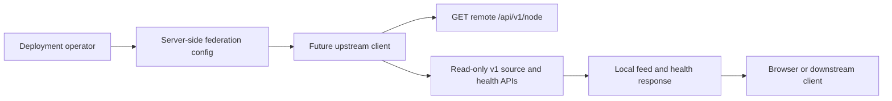

# LatestNews Node Federation Contract

状态：R4-A 设计基线。本文定义后续节点联邦的协议边界；不新增运行时接口，不改变现有 `/api/v1/node` 的响应，也不启用任何远端请求。

## 目标与边界

节点联邦让一个 LatestNews 部署可以受控地读取另一个部署的公开、只读源信息与条目，并在远端失败时继续提供本节点数据。

- 上游节点（upstream）：被当前节点读取的远端 LatestNews 部署。
- 下游节点（downstream）：由当前节点向其提供联邦数据的受控客户端。
- 操作员：配置受信任节点地址和凭据的部署管理员。

本阶段不做以下事情：浏览器提交任意节点地址、跨节点写入、转发用户 Cookie、复用 SyncHub API Key、自动发现并连接互联网中的节点。



## Existing Discovery Contract

R4-B 的第一步固定为请求受配置保护的上游根地址上的 `GET /api/v1/node`。当前节点清单已经提供以下稳定信息：

- `data.node.id`、`data.node.name`、`data.node.version`：远端身份和应用版本。
- `data.apiBasePath` 与 `data.endpoints`：公开只读 API 的相对路径。
- `data.sources`、`data.columns`、`data.summary`：能力选择所需的源元数据。
- `data.health`：远端健康摘要；它是提示，不是本地可用性的前提。
- `data.connections`：仅为人工部署提示。客户端不得把远端清单中的上游或下游地址当作新的连接目标。

所有路径都相对于操作员配置的上游 origin 解析。客户端不得将 `endpoints` 中的绝对 URL、不同 origin 的 URL、带用户名密码的 URL 或重定向结果作为下一跳。

当前 `/api/v1/node` 没有联邦协议版本字段。因此 R4-B 只支持“清单可解析且包含所需只读端点”的兼容基线；缺少后续扩展字段不能导致当前公开 v1 API 失败。

## Proposed Capability Extension

R4-C 之前如需协商联邦特性，只能以向 `data` 添加可选 `federation` 字段的方式扩展节点清单：

```json
{
  "federation": {
    "protocolVersion": "1.0",
    "capabilities": ["source-metadata", "source-items", "source-health"],
    "authentication": {
      "downstream": "bearer"
    }
  }
}
```

规则：

- `protocolVersion` 使用 `major.minor`。不同 major 不兼容；同 major 时客户端忽略未知 capability。
- capability 是显式允许列表，不能由 URL 存在性或应用版本猜测。
- 缺少 `federation` 时，客户端仅使用现有 v1 清单确认过的只读端点，不发送联邦鉴权头。
- 新 capability 必须先在本文和 OpenAPI 中说明，再被客户端使用。

## Upstream Request Rules

R4-B 的上游客户端只能运行在服务端。节点地址只可来自运行时环境配置或部署期允许列表，浏览器参数、请求体、查询参数和远端清单提示均不得改变目标地址。

地址验证在 DNS 解析前和连接前都必须执行：

- 生产环境只接受 `https:`；本地开发可由显式开发开关允许 `http:`。
- 拒绝用户名密码、非标准端口（除非允许列表明确给出）、IP 字面量重写和 URL fragment。
- 拒绝 loopback、link-local、private、carrier-grade NAT、unspecified、multicast 和 IPv6 local 网段，以及解析到这些地址的域名。
- 禁止自动跟随重定向；任何 3xx 都是上游协议错误。
- 请求只发送 `Accept: application/json`、显式 `User-Agent` 和可选联邦凭据；不得转发客户端 Cookie、`Authorization`、IP 地址或浏览器标识。

首次握手顺序固定如下：

1. 验证操作员配置的 origin，并请求 `/api/v1/node`。
2. 校验 JSON、公共响应信封、节点 ID、端点相对路径与所需 capability。
3. 读取 `/api/v1/openapi.json` 仅作诊断和人工契约比对，不在请求路径中动态执行任意 schema。
4. 依据清单中受支持的只读端点请求源元数据、健康或条目。
5. 将远端错误映射为本地联邦诊断，不让其覆盖本地缓存、Feed 或健康数据。

## R4-B Runtime Surface

R4-B 提供 `GET /api/v1/federation/upstream` 作为本节点的只读诊断入口。它没有 endpoint、token 或目标路径参数，只读取部署环境中的 `LATESTNEWS_UPSTREAM_ENDPOINT`、可选 `LATESTNEWS_FEDERATION_UPSTREAM_TOKEN` 和本地开发专用的 `LATESTNEWS_FEDERATION_ALLOW_HTTP=true`。

- 未配置上游时，接口返回 `data: null`、`configured: false` 和空错误列表；不会创建任何外部请求。
- 读取成功后，接口返回已验证的远端清单与远端节点 ID。远端的端点只能是同 origin 的相对只读 API 路径。
- 配置错误、无效清单、协议不兼容、超时和不可用分别映射为本文定义的机器可读错误码及 400、502、426、504、503 状态。
- Node server 使用已验证的 DNS 地址作为连接 lookup，避免验证完成后再次进行可被重绑定的 DNS 查询。Cloudflare Pages 没有等价的连接固定器时必须安全失败，不能降级为未校验的直接 fetch。
- 该诊断接口不参与 Feed、健康或缓存的本地结果计算；上游故障不会使本节点公开 v1 API 变为空数据。

## R4-C Runtime Surface

R4-C 在同一 `GET /api/v1/federation/upstream` 诊断响应中补充本节点可用的健康摘要，而不把远端失败伪装成空本地数据：

- `meta.localHealth` 始终包含本节点来源的更新时间、总数、正常、异常、未采样和缓存降级计数；它不包含远端来源条目。
- `meta.upstream.status` 为 `not_configured`、`healthy` 或 `degraded`，并包含可序列化的熔断快照：`closed`、`open` 或 `half_open`、连续失败数和可用时的下一次探测时间。
- 熔断器按已规范化的上游 origin 保存在当前服务进程内。连续 3 次**终态可重试**失败后打开 30 秒；到期后仅一个请求可以作为半开探测，成功后关闭，失败后重新打开。
- 连接失败和超时会在总请求内进行一次带抖动的指数退避重试。收到了 HTTP 响应后的 4xx/5xx、重定向和无效清单不会在同一次请求内重试；可重试的终态错误仍会进入熔断器计数。
- 熔断打开时接口返回 `federation_circuit_open`、503 和本地健康摘要，不再解析 DNS 或发起远端请求。Feed、来源和本地健康接口仍完全独立。

## Timeout, Retry, And Circuit Policy

R4-B 使用以下总预算，具体实现可以更短，不能更长：

| Request | Total timeout | Retry eligibility |
| --- | ---: | --- |
| Node manifest | 3 seconds | One retry for connection reset or timeout before response headers. |
| Source metadata or health | 4 seconds | One retry for the same transient conditions. |
| Source item or batch read | 8 seconds | One retry only when request is known to be read-only and no response body was received. |

- 不重试 4xx、无效 JSON、响应信封错误、3xx、地址校验失败或取消请求。
- 重试采用带随机抖动的指数退避，初始 250ms，上限 1s，且必须留在总预算内。
- R4-C 的熔断器按上游 origin 维护：连续 3 次可重试失败后打开 30 秒；半开状态只允许一个探测请求；成功探测关闭熔断器。
- 熔断器打开或上游失败时返回本节点可用数据和本地健康摘要；联邦字段必须标记为降级，不能把远端空响应当作本地空结果。

## Error Envelope And Diagnostics

未来联邦专用接口使用本项目既有的 `data`、`meta`、`errors` 外层结构，并在 `errors` 项中增加机器可读字段：

```json
{
  "data": null,
  "meta": { "generatedAt": 1783512000000, "upstreamNodeId": "news-a" },
  "errors": [
    {
      "code": "federation_upstream_timeout",
      "message": "Upstream node did not respond before the request deadline.",
      "retriable": true
    }
  ]
}
```

| Code | HTTP status | Retriable | Meaning |
| --- | ---: | --- | --- |
| `federation_endpoint_rejected` | 400 | No | Address violates server-side federation policy. |
| `federation_manifest_invalid` | 502 | No | Manifest is not valid JSON or lacks a required read-only contract. |
| `federation_protocol_unsupported` | 426 | No | Remote major protocol version is incompatible. |
| `federation_upstream_timeout` | 504 | Yes | Remote node exceeded the applicable total budget. |
| `federation_upstream_unavailable` | 503 | Yes | Connection or 5xx failure after retries. |
| `federation_circuit_open` | 503 | Yes | Remote origin is temporarily quarantined by the circuit breaker. |
| `federation_auth_required` | 401 | No | Downstream caller did not provide a valid federation credential. |
| `federation_access_denied` | 403 | No | Credential lacks the requested scope or node allow-list access. |
| `federation_rate_limited` | 429 | Yes | Downstream exceeded its route or node rate budget. |

Logs and diagnostics may include the configured origin, node ID, status, attempt count and duration. They must not include API keys, bearer tokens, authorization headers, response bodies containing credentials or browser-supplied addresses.

## Authentication Boundary

Public current v1 endpoints remain public according to their deployment setting. Federation does not silently change their access policy.

- R4-B upstream reads are unauthenticated by default. If an operator configures a private upstream, use a dedicated server-side federation bearer token and an explicit node allow-list.
- SyncHub keys (`shk_...`) are only for SyncHub collections and are never valid federation credentials.
- R4-D introduces a dedicated downstream bearer credential namespace, per-node scopes and key identifiers for audit. It must store only a non-reversible key verifier, support rotation and emit an audit event for accepted and rejected requests.
- Browser clients never receive federation credentials. They continue to call this node's normal public or deployment-protected API.

## Delivery Sequence And Test Matrix

| Slice | Implementation boundary | Required evidence |
| --- | --- | --- |
| R4-A | This contract only. | `git diff --check`; existing `/api/v1/node` and OpenAPI tests remain green. |
| R4-B | Server-side read-only upstream client plus URL policy. | Fixtures for valid manifest, missing endpoint, incompatible version, private/loopback address, DNS-rebound result, timeout, non-JSON and 5xx; `pnpm typecheck`; Node-server local API probe. |
| R4-C | Per-origin circuit breaker and degraded health summary. 已完成。 | Deterministic timer tests for opening, half-open probe, recovery and local-data fallback. |
| R4-D | Downstream auth, scope checks, audit fields and rate limits. | Auth missing/invalid/rotated key tests, scope-denial tests, rate-limit tests and secret-redaction review. |

No slice may modify existing `/api/v1/node` fields incompatibly. Any new network path must have focused tests before it is connected to Feed or public v1 responses.
